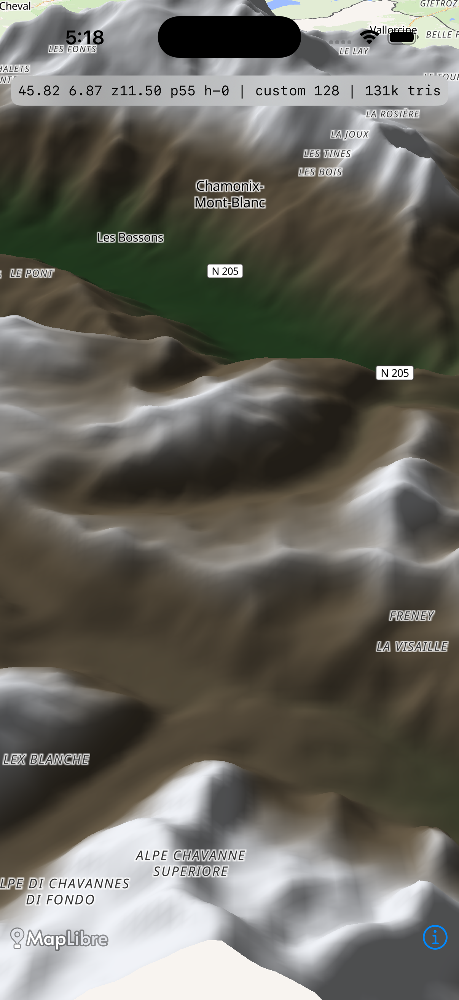
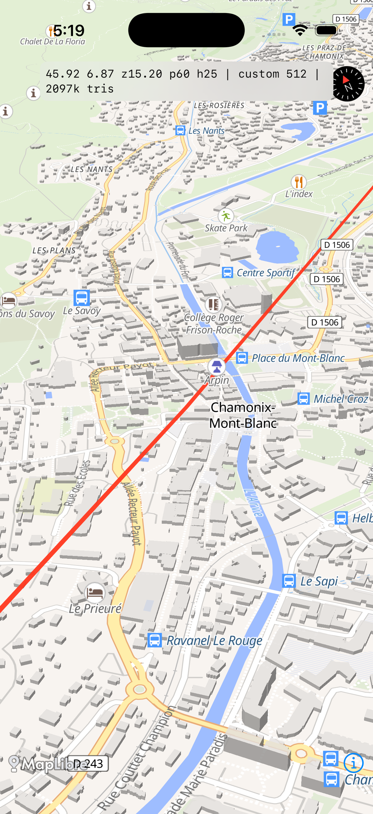

# Spike 3D : verdict sur un renderer Metal custom pour le terrain

> Question : peut-on héberger un maillage de terrain rendu en Metal **sous** les étiquettes et les
> calques de la carte MapLibre Native, avec la même caméra et la même profondeur, et à quel prix ?
> Réponse : **l'API existe et le rendu fonctionne**, mais l'adoption n'est pas recommandée
> maintenant. Le relief natif M-1 (hillshade) et l'écran Relief M-2 (MapLibre GL JS) couvrent le
> besoin visible sans ce coût. Un trigger précis est donné au §6.

## 1. Verdict en trois phrases

1. `MLNCustomStyleLayer`, public et marqué expérimental dans MapLibre Native iOS 6.31.0, donne à une
   couche Metal l'encodeur de la carte, sa passe de rendu, son tampon de profondeur et sa matrice de
   projection : un maillage DEM du Mont Blanc se dessine bien sous les étiquettes et suit la caméra
   à moins de 4 × 10⁻⁹ pixel près.
2. Le coût mesuré est réel mais acceptable en rendu pur (131 000 à 2 097 152 triangles, 1,9 à
   46,5 ms de construction, 3,7 à 58,8 Mio de tableaux, 54,9 à 57,4 fps au simulateur) ; le coût
   d'intégration, lui, ne l'est pas : la ligne d'itinéraire disparaît sous le relief, les bâtiments
   ne sont pas drapés, et il manque le LOD, l'ombrage, l'eau, le hors ligne et le passage sur
   iPhone.
3. Recommandation : **ne pas lancer ce chantier**. Garder M-1 (hillshade natif) et M-2 (terrain
   GL JS) ; ne rouvrir la voie (a) que si M-2 est refusé pour le hors ligne **et** si le terrain 3D
   dans la carte principale devient une exigence produit.

## 2. Méthode

- **Application jetable.** `tools/ios-terrain-spike/` (XcodeGen, SwiftUI) ne partage aucun fichier
  avec `iosApp/`. Elle épingle MapLibre `6.31.0`, la même version SPM que l'app, pour tester l'API
  réellement liée par Vela. Un `MLNMapView`, le style distant OpenFreeMap Liberty (étiquettes,
  routes, `building-3d`), une couche `MLNCustomStyleLayer` insérée sous `road_area_pattern`, une
  ligne d'itinéraire GeoJSON insérée sous les étiquettes, et une vue `MTKView` sœur pour la voie (b).
- **API testée.** La couche reçoit dans `draw(in:with:)` un `MTLRenderCommandEncoder`, un
  `MTLRenderPassDescriptor`, la matrice `projectionMatrix`, le centre, le zoom, le cap, l'inclinaison
  et le champ de vision. La passe de la carte porte un attachement de profondeur
  (`depth32Float_stencil8`, format brut 260) et une cible couleur `bgra8Unorm` (80). La couche écrit
  dans la profondeur de la carte avec `lessEqual`, sans changer de passe.
- **DEM.** Quatre tuiles terrarium z11 fixées sur le Mont Blanc et Chamonix
  (`11/1062..1063/729..730`, 582 272 octets). Décodage `R*256 + G + B/256 - 32768`, grille indexée
  de 128, 256 ou 512 quads par tuile, normales par différences finies, ombrage lambertien dans le
  fragment shader. La hauteur est passée en mètres : `worldToCamera` de MapLibre applique déjà
  `pixelsPerMeter` sur Z.
- **Mesures.** Construction du maillage et téléversement GPU chronométrés ; fps et temps CPU par
  image mesurés pendant un panoramique de 4 s par résolution ; images comptées dans `draw` ; période
  immobile de 2 s pour l'on-demand ; empreinte `phys_footprint` ; sonde de caméra comparant, sur une
  grille de 5 x 5 points, la projection du maillage et `MLNMapView.convert` dans cinq états
  (pitch 0, pan, zoom, rotation, pitch 60).
- **Où.** Runner `macos-latest` du builder, macOS 26.6.2, Xcode 26.6 (17F113), simulateur iPhone 17
  (iOS 26.5), écran 402 x 874 pt à 3x.
- **Reproduction.** Depuis le worktree :
  `~/gmaps/ios-builder/scripts/mac-run.sh /home/antoine/gmaps/wt/spike-3d spike-3d scripts/ios/ci-terrain-spike.sh`
  (script `scripts/ios/ci-terrain-spike.sh`, `STATUS`, `log.txt` et `summary.txt` dans `$OUT`).
  Les tuiles sont vérifiées par `scripts/ios/fetch-terrain-dem.sh`, qui épingle taille et source.

## 3. Runs

Deux lancements, budget consommé.

| Run | Tag | Résultat |
|---|---|---|
| 1 | `spike-3d-20261028-170222-26786` | échec de compilation : `insertLayer(_:belowLayer:)` renommé en `insertLayer(_:below:)` dans cette version ; aucune app lancée |
| 2 | `spike-3d-20261028-171055-20256` | vert : build, DEM, trois résolutions, cinq sondes de caméra, trois captures, voie overlay mesurée |

Les fichiers du run 2 sont dans
`tools/ios-terrain-spike/results/spike-3d-20261028-171055-20256/` (rapport JSON, résumé, console,
captures).

## 4. Mesures

### 4.1 API et passe de rendu

| Sonde | Valeur |
|---|---|
| Classe | `MLNCustomStyleLayer`, en-tête marqué « This API experimental » |
| Même passe que la carte | oui, `renderPassDesc` et `renderEncoder` fournis |
| Attachement de profondeur | présent, `depth32Float_stencil8` (format 260) |
| Couleur | `bgra8Unorm` (format 80) |
| Matrice de projection | fournie à chaque image, sans recalcul |
| Caméra | centre, zoom, cap, pitch, champ de vision fournis |
| Limite de pitch de la carte | 60 degrés |
| Profondeur partagée en pratique | oui pour la passe, non pour le compositing : les calques 2D de la carte n'écrivent pas de profondeur, les lines en lisent une |

Conclusion API : **aucun blocage d'API**. Le « custom layer » iOS n'est pas l'API Android
`CustomLayer` avec géométrie fournie, mais une couche Metal brute dans la passe de la carte. Elle
suffit à héberger un maillage, et c'est la première fois que ce point est prouvé dans ce portage.

### 4.2 DEM et maillages

| Résolution | Triangles | Construction | Téléversement GPU | Tableaux | Empreinte ajoutée | fps | CPU par image |
|---|---:|---:|---:|---:|---:|---:|---:|
| 128 quads/tuile | 131 072 | 1,9 ms | 6,3 ms | 3,69 Mio | +3,75 Mio | 54,9 | 5,27 ms |
| 256 quads/tuile | 524 288 | 8,3 ms | 42,5 ms | 14,71 Mio | +18,55 Mio | 57,4 | 5,22 ms |
| 512 quads/tuile | 2 097 152 | 46,5 ms | 141,5 ms | 58,79 Mio | +77,43 Mio | 55,6 | 4,63 ms |

- Téléchargement et décodage des 4 tuiles : 1 515 ms pour 582 272 octets, réseau compris.
- Empreinte du processus à la fin : 232 Mio. Les trois maillages sont gardés en mémoire pendant le
  spike ; une app réelle n'en garde qu'un, mais doit ensuite ajouter le cache de tuiles et le LOD.
- Le temps de construction est mesuré sur le CPU du Mac en Release. Il ne représente pas un iPhone
  SE ni un iPhone 12 ; c'est un ordre de grandeur, pas une promesse.
- Les fps du simulateur plafonnent à 60 Hz et ne mesurent ni le GPU, ni la chauffe, ni le throttling.

### 4.3 Caméra

Cinq états, grille de 21 à 25 points visibles, comparaison avec `MLNMapView.convert` :

| État | Zoom réel | Pitch | Cap | Erreur max | Erreur moyenne | Élévation au-dessus du point plat |
|---|---:|---:|---:|---:|---:|---:|
| pitch 0 | 13,80 | 0 | 0 | ≤ 3,2 × 10⁻⁹ px | ≤ 1,8 × 10⁻⁹ px | 349,3 px |
| pan | 13,00 | 0 | 0 | ≤ 3,2 × 10⁻⁹ px | ≤ 1,8 × 10⁻⁹ px | 95,2 px |
| zoom | 15,00 | 0 | 0 | ≤ 3,2 × 10⁻⁹ px | ≤ 1,8 × 10⁻⁹ px | valeur dégénérée, non retenue |
| rotation | 13,00 | 0 | 45 | ≤ 3,2 × 10⁻⁹ px | ≤ 1,8 × 10⁻⁹ px | 135,8 px |
| pitch 60 | 12,00 | 60 | 20 | ≤ 3,2 × 10⁻⁹ px | ≤ 1,8 × 10⁻⁹ px | 203,6 px |

La synchronisation de caméra est **exacte à la précision du flottant** : le maillage réutilise la matrice de
la carte, il n'y a pas de modèle de caméra à réconcilier. Au pitch 60, une crête réelle monte
d'environ 204 px au-dessus de sa position cartographique plate ; ce n'est pas une erreur de
synchronisation, c'est le relief qui est demandé.

Deux réserves. D'abord, le helper de caméra du spike perd le zoom demandé quand il règle le pitch
après `setCenter` : le zoom réel est plus bas que le zoom demandé (13,80 au lieu de 13, 11,5 au lieu
de 12,3 sur la capture). Cela ne change pas la validité de la sonde, qui lit le zoom réel, mais un
lot réel doit régler altitude et pitch dans le même `MLNMapCamera`. Ensuite, la sonde mesure la
concordance des matrices, pas la concordance des pixels rendus ; une comparaison de captures serait
la preuve suivante.

### 4.4 Rendu continu et on-demand

| Mode | Images | Durée | fps | CPU par image |
|---|---:|---:|---:|---:|
| Custom, panoramique | 248 à 253 | 4,4 à 4,5 s | 54,9 à 57,4 | 4,6 à 5,3 ms |
| Custom, caméra immobile | 0 | 2,1 s | 0 | sans objet |
| Overlay, caméra immobile | 260 | 4,4 s | 59,1 | 1,91 ms |

Le mode custom hérite de l'on-demand de MapLibre : caméra immobile, zéro image, donc pas de coût
batterie au repos. C'est un point positif. La voie overlay, elle, dessine en continu à 60 Hz avec un
`MTKView` non pausé : elle ajoute une boucle de rendu permanente, même quand rien ne bouge.

### 4.5 Occlusion

| Élément | Résultat |
|---|---|
| Étiquettes | **au-dessus du relief**, lisibles (Chamonix-Mont-Blanc, Les Bossons, N-205). Les symboles sont insérés après le terrain et ne lisent pas la profondeur |
| Ligne d'itinéraire | **disparue sur le relief** dans la capture de la vallée. Elle est insérée après le terrain, mais les couches `line` lisent la profondeur ; la ligne est au niveau zéro et le terrain écrit une profondeur plus proche. Sur la carte plate, la même ligne est bien visible en rouge |
| Bâtiments | non observés au-dessus du terrain. `building-3d` est une extrusion à base zéro ; avec un DEM réel elle est enterrée ou rejetée par le test de profondeur tant que la base n'est pas calée sur le terrain. C'est un travail d'intégration, pas un réglage |
| Profondeur | même passe et même attachement, mais « partager la profondeur » ne veut pas dire que la carte et le terrain se composent gratuitement : les calques 2D qui écrivent ou lisent la profondeur changent de comportement |

C'est le résultat central du spike : l'API héberge le maillage, mais le contrat de profondeur de la
carte n'est pas conçu pour un sol surélevé. Sans drapage des routes et des bâtiments, on obtient un
relief sous les étiquettes et un relief qui cache l'itinéraire.

### 4.6 Captures

Les trois fichiers sont dans
`tools/ios-terrain-spike/results/spike-3d-20261028-171055-20256/`.

| Fichier | État réel |
|---|---|
| `terrain-valley.png` | **custom 128**, z11,5, pitch 55, cap 0 : relief ombré du massif, étiquettes lisibles, ligne d'itinéraire absente |
| `terrain-tilted.png` | **défaut de capture** : l'écran est en mode overlay, z15,2, pitch 60, cap 25 ; carte plate avec la ligne rouge et les bâtiments, sans terrain |
| `terrain-overlay.png` | **défaut de capture** : l'image montre la dernière frame du mode overlay alors que le bandeau affiche déjà « custom 512 » ; le terrain n'y est pas |

Cause : `simctl io screenshot` a mis 15 à 20 s sur ce runner, alors que chaque état n'est tenu que
5 s. Les deux captures de Chamonix sont donc arrivées après le changement d'état. C'est le même
défaut que celui documenté par G-1. Seule la capture de la vallée est utilisable comme preuve du
rendu custom. Le pitch 60 est prouvé par la sonde (pitch réel 60, 24 points, erreur nulle) et par
les fps à pitch 55, pas par une image propre.






## 5. Les deux voies comparées

| Critère | (a) Couche custom dans la carte | (b) Vue Metal sœur synchronisée |
|---|---|---|
| API | `MLNCustomStyleLayer`, expérimentale | `MTKView` au-dessus de `MLNMapView` |
| Caméra | matrice fournie par la carte, erreur nulle mesurée | modèle de caméra à recalculer (altitude, fov, pitch, échelle), une frame de retard possible |
| Profondeur | même passe, même attachement, écriture possible | profondeur séparée, aucune interaction avec la carte |
| Étiquettes | au-dessus du terrain, correct | recouvertes par le terrain, ou transparence à gérer |
| Routes | recouvertes par le relief tant que la profondeur n'est pas traitée | recouvertes par le terrain dans la zone du maillage |
| Rendu observé | fonctionne, 54,9 à 57,4 fps | 260 images en 4,4 s (59,1 fps) mais terrain **non visible** dans la capture |
| Coût CPU | 4,6 à 5,3 ms par image pendant le mouvement, 0 au repos | 1,91 ms par image, mais boucle continue à 60 Hz |
| Effort estimé | 8 à 11 sessions d'agent | 10 à 14 sessions, avec un défaut de compositing non résolu |
| Risque principal | profondeur, drapage, LOD, hors ligne | compositing, double caméra, deux boucles de rendu, batterie |
| Verdict | seule voie acceptable si le 3D dans la carte devient obligatoire | à écarter |

Le chiffre de 1,91 ms de la voie (b) ne mesure que l'encodage du maillage sur une carte immobile. Il
ne mesure pas le coût de composition de deux surfaces, et il est obtenu alors que le terrain n'est
pas visible. Il ne doit pas servir à conclure que (b) est moins chère.

La voie (b) n'a pas seulement un problème d'alignement : elle ne peut pas, par construction,
laisser les étiquettes et les routes de la carte au-dessus du terrain, puisque la vue Metal est
au-dessus de toute la carte. C'est un défaut produit, pas un bug à corriger.

## 6. Recommandation et trigger

**Ne pas adopter de renderer Metal custom pour la carte principale.** Le besoin « montagne en 3D »
se couvre en deux temps avec les lots déjà prévus :

1. **M-1** : hillshade natif avec `MLNRasterDEMSource` en terrarium, plafonné à z16, sous les routes,
   sans hors ligne. C'est du relief ombré, pas de la géométrie 3D, et c'est le meilleur rapport
   coût/rendu pour la carte principale.
2. **M-2** : écran Relief séparé en MapLibre GL JS, avec terrain, ciel et atmosphère, en lecture
   seule, sans hors ligne. C'est là que la vraie 3D apparaît, sans toucher au contrat de profondeur
   de la carte native.

Trigger d'adoption de la voie (a), à réévaluer seulement si les trois conditions sont réunies :

- M-2 est **refusé pour le hors ligne** ou pour une raison produit qui interdit une WebView ;
- le terrain 3D **dans la carte principale** devient une exigence, pas une animation ;
- MapLibre Native n'expose toujours pas d'API terrain native à ce moment-là.

Si le trigger se déclenche, repartir de ce spike avec un budget de 8 à 11 sessions, et traiter
d'abord les deux points qui ont échoué ici : drapage des routes et des bâtiments sur le DEM, puis
LOD et cache hors ligne. Si MapLibre Native ajoute `MLNTerrain` entre-temps, l'utiliser et fermer le
sujet : le renderer custom n'a plus de raison d'être.

## 7. Effort pour une première implémentation

Estimation en sessions d'agent, pour un premier lot utilisable sur iPhone, pas pour un prototype de
spike :

| Travail | Sessions |
|---|---:|
| Pipeline DEM, cache disque, tuiles hors ligne, erreurs réseau | 2 |
| Maillage indexé, LOD par zoom, streaming et libération mémoire | 2 |
| Pipeline Metal, shaders, ombrage, couleur par altitude, antialiasing | 1 à 2 |
| Drapage routes, bâtiments et étiquettes, contrat de profondeur | 2 |
| Caméra, gestes, pitch 60, réglages iPhone et chauffe | 2 |
| Tests, captures, documentation, notices | 1 |
| **Total** | **10 à 11** |

La voie (b) demande 2 à 3 sessions de plus pour recalculer la caméra et gérer la transparence, et
elle reste bloquée sur l'occlusion des étiquettes et des routes.

## 8. Ce qui manquerait après une première implémentation

- **Ombres portées** : le spike n'a qu'un lambertien par normale. Une ombre de relief demande une
  carte d'ombre, une passe supplémentaire et un réglage de biais.
- **Éclairage** : direction fixe, pas d'heure du jour, pas d'éclairage par zone, pas de lumière
  ambiante correcte.
- **Eau** : rivières et lacs ne sont pas drapés sur le maillage ; le style les dessine à plat.
- **LOD et streaming** : quatre tuiles fixes chargées au lancement. Il manque la pyramide de
  tuiles, le remplacement progressif, le cache et la libération mémoire pendant le déplacement.
- **Hors ligne** : aucune tuile DEM en cache, aucun manifeste, aucune politique de rétention.
- **Drapage** : routes, bâtiments et étiquettes restent à plat ; c'est le point bloquant observé.
- **Atmosphère et horizon** : pas de brouillard de distance, pas de ciel, pas de fondu au loin.
- **Textures** : pas de texture satellite, pas de normal map, pas de variation de sol.
- **Performance iPhone** : tout est mesuré au simulateur. Il manque les fps, la chauffe, la mémoire
  et le throttling sur un iPhone SE et un iPhone 12.
- **Tests** : aucune suite de tests, seulement le rapport d'un run.

## 9. Source DEM, licence et attribution

- **Source** : AWS Open Data `elevation-tiles-prod`, les tuiles de terrain Mapzen, encodage
  terrarium. URL épinglée :
  `https://s3.amazonaws.com/elevation-tiles-prod/terrarium/{z}/{x}/{y}.png`.
- **Licence** : conditions multiples, pas une licence unique. Le composite Mapzen couvre du
  domaine public, du CC BY 3.0 et 4.0, de l'Open Government Licence et la licence Copernicus selon
  la région. L'attribution est obligatoire pour chaque source utilisée ; la page de référence est
  `https://github.com/tilezen/joerd/blob/master/docs/attribution.md`.
- **Attribution à afficher** (tuiles Europe utilisées ici) : « Terrain data: Mapzen terrain tiles
  (AWS Open Data elevation-tiles-prod). Europe: EU-DEM (Copernicus). Global: ETOPO1 (NOAA),
  GMTED2010 and SRTM (USGS). See tilezen/joerd attribution. » La liste exacte dépend des zones
  livrées : un lot mondial doit reprendre la liste complète, pas seulement la ligne Europe.
- **Notice** : `tools/` n'est pas scanné par `scripts/ios/check_notices.py`, donc ce spike ne
  l'exige pas. Le lot M-1 ou M-2 qui livrera le relief devra ajouter une notice
  `mapzen-terrain` (ou étendre la notice existante) avec la ligne ci-dessus, et la mapper dans
  `VENDOR_FRAMEWORKS` si nécessaire. OpenFreeMap Liberty et MapLibre ont déjà leurs notices.

## 10. Ce qu'il faut faire ensuite si l'utilisateur veut des montagnes

1. Ne pas ouvrir de chantier renderer. Le besoin est couvert par M-1 et M-2.
2. Livrer M-1 d'abord : `MLNRasterDEMSource` en terrarium, hillshade sous les routes, plafond z16,
   désactivé hors ligne. C'est le gain visible le plus rapide, sans dette de profondeur.
3. Livrer M-2 ensuite : écran Relief GL JS avec terrain, ciel et atmosphère, centrage synchronisé,
   retour instantané, lecture seule. Vérifier le hors ligne explicitement : c'est le seul point qui
   peut rouvrir ce spike.
4. Si M-2 est refusé pour le hors ligne, revenir ici avec le trigger du §6, un budget de 8 à 11
   sessions, et commencer par le drapage routes et bâtiments. Ne pas commencer par le shader.
5. Dans tous les cas, refaire une passe iPhone réelle avant de promettre une animation 3D : le
   simulateur ne mesure ni la chauffe, ni la batterie, ni le throttling.

## 11. Livraison M-2 : écran Relief en MapLibre GL JS

État : lot M-2, 29 octobre 2026, branche `ios/m2-terrain`. Ce lot livre un écran séparé, en
lecture seule, qui montre un terrain réellement déformé avec un ciel et une atmosphère. Il ne
remplace pas le relief natif M-1 : il le complète là où MapLibre Native ne sait pas faire de
géométrie 3D ni de ciel.

### 11.1 Ce que l'écran montre, comparé à M-1

| Critère | M-1 dans la carte native | M-2, écran Relief |
|---|---|---|
| Relief | hillshade raster sous les routes, plafonné à z16 | terrain déformé (maillage DEM), sur toute la vue |
| Bâtiments | extrusions natives dès z16, au-delà de 20 degrés | bâtiments à plat dans le style, pas d'extrusion |
| Ciel | absent, MapLibre Native ne rend pas `sky` | couche `sky` GL JS avec horizon et brouillard de sol |
| Atmosphère | aucune | `fog-color`, `sky-horizon-blend` et `horizon-fog-blend` |
| Caméra | celle de l'app, persistée | caméra propre à l'écran, pitch initial 70 degrés |
| Interaction avec l'app | itinéraires, épingles, couches | aucune, l'écran est autonome et se ferme |
| Hors ligne | relief masqué, carte conservée | écran dit « Terrain is unavailable », pas de carte plate |

L'écran ouvre sur Chamonix (45,9237 N, 6,8694 E), z10,6, pitch 70 et cap -18 : la vallée, le
massif du Mont Blanc et l'horizon du ciel sont visibles dès le premier rendu. La vue se manipule (pan, pincement,
rotation, inclinaison jusqu'à 85 degrés) mais ne renvoie rien à la carte native et ne modifie
aucune préférence.

### 11.2 Ce qui est embarqué, et pourquoi

| Fichier | Octets | Rôle |
|---|---:|---|
| `iosApp/Vela/Resources/terrain/maplibre-gl.js` | 1 056 837 | rendu WebGL, terrain, ciel, brouillard |
| `iosApp/Vela/Resources/terrain/maplibre-gl.css` | 70 024 | contrôles et attribution |
| `iosApp/Vela/Resources/terrain/index.html` | 11 662 | document local, style construit en mémoire |
| `iosApp/Vela/Resources/terrain/LICENSE.txt` | 5 984 | texte BSD-3-Clause de MapLibre GL JS |
| `iosApp/Vela/Resources/terrain/VERSION` | 416 | version, source et empreintes |
| **Total** | **1 144 923** | environ 1,1 Mio dans l'IPA |

- **Version épinglée** : `maplibre-gl` **5.24.0**, paquet npm
  `https://registry.npmjs.org/maplibre-gl/-/maplibre-gl-5.24.0.tgz`, intégrité SHA-512
  `ALyFxgtd5R+65UqZ/++lOqwWcC0SNho9c27fYSyLmG7AfnAul2o46F05aDJGPbFU57wos9dgcIySHs0Xe6ia3A==`.
  `VERSION` porte aussi les SHA-256 des deux fichiers livrés.
- **Licence** : BSD-3-Clause, texte complet dans `LICENSE.txt`, notice `maplibre-gl-js` dans
  `iosApp/Vela/Settings/Notices.json`.
- **Pourquoi embarqué** : l'écran doit s'ouvrir sans dépendre d'un CDN, d'une version qui bouge
  ou d'un réseau disponible pour le moteur lui-même. Le document, le style, le JavaScript et le
  CSS viennent tous du bundle ; seules les tuiles et les glyphes sont distants.
- **Pas de style serveur** : `index.html` construit un style minimal en mémoire (fond, occupation
  du sol, eau, relief ombré, bâtiments à plat, routes, frontières, étiquettes de lieux) et pointe
  la même source vectorielle OpenFreeMap que l'app, `https://tiles.openfreemap.org/planet`, avec
  les glyphes et sprites OpenFreeMap. Aucune URL de style n'est téléchargée.
- **Origine de la page** : les trois fichiers embarqués sont assemblés en une seule chaîne
  (`index.html`, puis le CSS et le JavaScript insérés à la place de leurs balises) et chargés avec
  l'origine `https://tiles.openfreemap.org/`. Le style, les tuiles et les glyphes sont donc
  same-origin, sans dépendre d'un en-tête CORS pour la carte. Si un fichier manque, le document
  local est chargé tel quel.

### 11.3 Source DEM, licence et attribution

Même source que M-1, donc une seule notice couvre les deux usages :

- source `raster-dem` terrarium, déclarée sur le protocole MapLibre `vela-dem` :
  `vela-dem://tile/{z}/{x}/{y}.png`. `addProtocol` appelle le pont Swift pour chaque tuile ;
  `TerrainDEMHandler` la traduit vers
  `https://s3.amazonaws.com/elevation-tiles-prod/terrarium/{z}/{x}/{y}.png` ;
- encodage `terrarium`, tuiles de 256 px, `minzoom` 0, `maxzoom` 15 ;
- exagération 1,35 ;
- notice existante `mapzen-terrain` (conditions multiples, attribution obligatoire) ;
- pourquoi le pont et pas une URL S3 directe : le bucket S3 ne renvoie aucun en-tête CORS, donc
  une page WKWebView ne peut pas lire ses tuiles directement, et `fetch` refuse les schémas
  personnalisés d'un `WKURLSchemeHandler`. `addProtocol` est le point d'entrée prévu par
  MapLibre GL JS pour une source `raster-dem` : le protocole `vela-dem` demande la tuile à Swift,
  URLSession la récupère, puis la page la reçoit en base64 et la rend à MapLibre comme image
  encodée. La source et l'attribution restent celles de M-1, une seule notice couvre les deux ;
- l'écran affiche en clair, dans un bandeau sombre, « Terrain: Mapzen terrain tiles (AWS Open
  Data elevation-tiles-prod). © OpenFreeMap © OpenMapTiles © OpenStreetMap contributors » ; le
  contrôle d'attribution GL JS est désactivé pour ne pas doubler ce bandeau.

### 11.4 Hors ligne : un refus explicite

L'écran ne fabrique jamais un terrain plat. Trois chemins mènent au même message :

1. `navigator.onLine === false` au chargement : la carte n'est pas créée du tout ;
2. l'évènement `offline` de la page : le message s'affiche et la carte est masquée ;
3. une erreur de la source `terrain` (tuile DEM injoignable, hôte bloqué) : le message remplace
   la carte, avec le texte « Terrain is unavailable. The elevation tiles need a network
   connection. »

Le reste de Vela n'est pas concerné : la carte native, ses tuiles vectorielles et son relief M-1
suivent leur propre politique. L'écran Relief ne promet pas de hors ligne et ne met aucune tuile
DEM en cache.

### 11.5 Cycle de vie : un seul WKWebView, détruit à la fermeture

- Un seul `WKWebView`, créé par `TerrainWebView` quand la feuille plein écran apparaît.
- Aucun minuteur Swift, aucune boucle, aucune tâche de fond, aucun lien vers la caméra de l'app.
- `dismantleUIView` arrête le chargement, retire le gestionnaire de messages, vide les scripts et
  charge une page blanche : le processus web est libéré avec la vue.
- Le JavaScript ne tourne que tant que la page est visible ; le rendu GL JS suit les évènements
  de la carte, sans animation permanente.
- Les requêtes de tuiles DEM passent par URLSession dans `TerrainDEMHandler` ; `shutdown()`
  annule les tâches en cours et invalide la session quand la feuille se ferme.
- La fermeture est un bouton X de 44 points, identifiant `terrain-close`, et un bouton `Close`
  quand le terrain est indisponible.

### 11.6 Entrée dans l'app

Le fichier `iosApp/Vela/Map/TerrainScreen.swift` porte le bouton autonome `TerrainButton`. Le lot
ne modifie pas `MapScreen.swift`, `MapView.swift`, `MapController.swift` ni la feuille de couches,
qui appartiennent au lot globe. La ligne exacte à poser dans la chrome de `MapScreen` est :

```swift
TerrainButton()
```

Le bouton s'occupe lui-même de la présentation (`fullScreenCover`), de son identifiant
`terrain-open` et de son libellé VoiceOver « Relief ». Aucun état à ajouter dans `MapScreen`.

Pour les tests seulement, une prise Debug `-VelaTerrainFixture` ouvre l'écran après le lancement
de la carte (`VelaApp.swift`, bloc `#if DEBUG`). Elle ne sert qu'à `TerrainUITests` et ne change
rien hors Debug.

### 11.7 Preuves

`TerrainUITests.testTerrainScreenRenders` ouvre l'écran par la prise Debug, attend
`terrain_web=1` et `terrain_dem=1`, vérifie la ligne d'attribution, prend `terrain-screen.png`,
recule pour montrer l'horizon et le ciel (`terrain-atmosphere.png`), puis ferme et vérifie le
retour à la carte. Lignes de rapport : `terrain_web=1`, `terrain_dem=1`, `terrain_state=ready`,
`terrain_return=1`.

La ligne de diagnostic Debug de l'écran est `terrain-debug` :
`terrain_doc=… terrain_web=… terrain_dem=… terrain_state=… terrain_offline=…
terrain_failure=…`. `terrain_doc` prouve que le document embarqué s'est exécuté avant tout
réseau ; `terrain_failure` garde la dernière erreur de style ou de tuile, sans espace.

Run de référence : tag **`m2-terrain-20261029-215904-20492`** (branche `results` du builder),
statut vert. Build simulateur réussi, 188 tests unitaires sans échec, `LaunchUITests` et
`TerrainUITests` verts. Le scénario Relief dure 54,6 s et rend
`terrain_web=1`, `terrain_dem=1`, `terrain_state=ready`, `terrain_return=1`, avec
`terrain-screen.png` et `terrain-atmosphere.png`. Les runs précédents ont servi à corriger, dans
l'ordre, une couche `sky` refusée par le style spec de GL JS 5, un schéma personnalisé refusé par
`fetch`, puis l'hôte `tile` du protocole `vela-dem` lu comme un segment de chemin.

### 11.8 Limites et risques

- Le WebGL de WKWebView dépend du simulateur et du GPU : sur ce runner il a fonctionné, mais le
  message « unavailable » apparaît si le contexte échoue, au lieu d'une fausse carte. Depuis le
  correctif de robustesse (§12), un échec WebGL est retenté une fois dans une nouvelle WKWebView.
  Un iPhone réel reste à mesurer.
- La mémoire, les fps et la chauffe d'un WKWebView avec terrain ne sont pas mesurés sur iPhone
  réel ; seul le simulateur iPhone 17 a rendu les captures.
- L'écran ne suit pas la caméra de la carte native : la synchronisation décrite dans le backlog
  est volontairement hors de ce lot, qui doit rester sans interaction avec `MapController`.
- Les libellés de l'écran sont en anglais ; ils ne passent pas encore par `VelaL10n`.
- Les tuiles DEM et vectorielles restent distantes ; aucun cache hors ligne.
- MapLibre GL JS 5.24.0 doit être remplacé et re-épinglé à chaque correctif de sécurité, avec
  `VERSION`, `LICENSE.txt` et la notice mis à jour ensemble.
- Le pont DEM ajoute un aller-retour Swift pour chaque tuile : à mesurer si un écran grand ou un
  zoom arrière charge beaucoup de tuiles à la fois.

## 12. Robustesse de l'état du relief

État : correctif du 30 octobre 2026, branche `ios/terrain-robust`. Le scénario
`LocalizationUITests.testFrenchTerrainScreen` avait reçu « Indisponible » alors que la fixture et
les tuiles étaient présentes. L'écran pouvait donc afficher son état d'échec sur un lancement lent
du simulateur, et le test dépendait d'un délai fixe au lieu de l'état réel.

### 12.1 Cause identifiée

Le gestionnaire `map.on("error")` de `index.html` traitait **toute** erreur de source comme une
panne définitive : une tuile DEM lente, une première tuile rejetée par le pont `vela-dem`, une
tuile vectorielle ou un glyphe manquant appelaient `showUnavailable("network")`. Cette fonction
détruisait la carte, retirait le gestionnaire et posait `terrain_state=unavailable` pour de bon,
même si la tuile suivante aurait suffi. Le message « Indisponible » venait de là, pas d'un échec
WebGL ni d'un défaut du protocole DEM.

Deux défauts voisins entretenaient la confusion :

- le cas hors ligne utilisait le même état et le même titre que l'échec du moteur ;
- un échec du contexte WebGL au démarrage n'avait aucune seconde chance, alors qu'un simulateur
  chargé peut refuser le premier contexte.

### 12.2 Règles de l'automate

| État | Sens | Ce qui le fait entrer | Ce qui le fait sortir |
|---|---|---|---|
| `loading` | démarrage normal | document chargé, carte créée, tuiles en cours | `dem` ou échec franc |
| `ready` | relief rendu | source `terrain` chargée et élévation lue, ou `sourcedata` | fermeture de l'écran |
| `offline` | pas de réseau | `navigator.onLine === false` ou évènement `offline` | fermeture de l'écran |
| `unavailable` | moteur ou document en échec | WebGL impossible, document introuvable, navigation ou script de démarrage en échec | un seul retry WebGL |

Une première image tardive, une tuile DEM lente ou une erreur de source ne changent plus l'état :
elles restent en `loading` et sont seulement consignées dans `terrain_failure`. Une erreur de
tuile ne peut donc plus fabriquer un faux « Indisponible ». Un échec WebGL est retenté une fois
dans une `WKWebView` neuve et la ligne de diagnostic porte alors `terrain_retry=1` ; un second
échec affiche le message.

Le hors ligne garde son propre message : la phrase réseau de `map_terrain_reason_offline` remplace
le titre générique, et la ligne de statut n'affiche jamais « Indisponible » dans ce cas.

### 12.3 Diagnostic

La ligne `terrain-debug` expose désormais :

```
terrain_doc=… terrain_web=… terrain_webgl=… terrain_dem=… terrain_frame=…
terrain_state=loading|ready|offline|unavailable terrain_retry=0|1
terrain_offline=0|1 terrain_failure=…
```

`terrain_frame=1` prouve qu'une image est arrivée, indépendamment du DEM. Les tests attendent
`terrain_state=ready` avec une échéance de 120 s et vérifient `terrain_webgl=1`, `terrain_dem=1`
et `terrain_frame=1`. Le scénario français attend le même état avant de lire le libellé, sans
`sleep` fixe.

### 12.4 Preuves

Deux runs Mac ont eu lieu sur le commit `521f075d` :

| Tag | Terrain | Localisation française du relief | Suite |
|---|---|---|---|
| `terrain-robust-20261030-121842-7441` | vert, 44,1 s | vert, 33,3 s | rouge sur un scénario sans rapport |
| `terrain-robust-20261030-125619-14723` | vert, 42,7 s | vert, 28,9 s | rouge sur le même scénario sans rapport |

Les deux runs rendent `terrain_state=ready`, `terrain_webgl=1`, `terrain_dem=1`,
`terrain_frame=1`, `terrain_retry=0`, `terrain_return=1` et le statut français
« Relief activé, ciel et atmosphère ». Le retry WebGL est donc resté inutilisé : le démarrage a
été rapide sur ce runner, et c'est la suppression du faux « Indisponible » qui rend le scénario
déterministe.

Le seul échec des deux runs est `LocalizationUITests.testFrenchPreviouslyUnlocalizedSurfaces`,
sur la ligne « Préparation du guidage GO » du parcours transit, un scénario que ce lot ne touche
pas. Il échoue de la même façon sur les deux runs et ne concerne ni le relief ni ses états.

### 12.5 Limites

- Un réseau réellement coupé alors que `navigator.onLine` reste vrai laisse l'écran en chargement,
  puisque seule la page peut signaler le hors ligne. Aucun message générique n'est fabriqué.
- Le retry WebGL ne couvre pas un contexte qui se perd après le premier rendu ; ce cas reste à
  instrumenter sur iPhone réel.
- Les tuiles DEM et vectorielles restent distantes, sans cache hors ligne.
